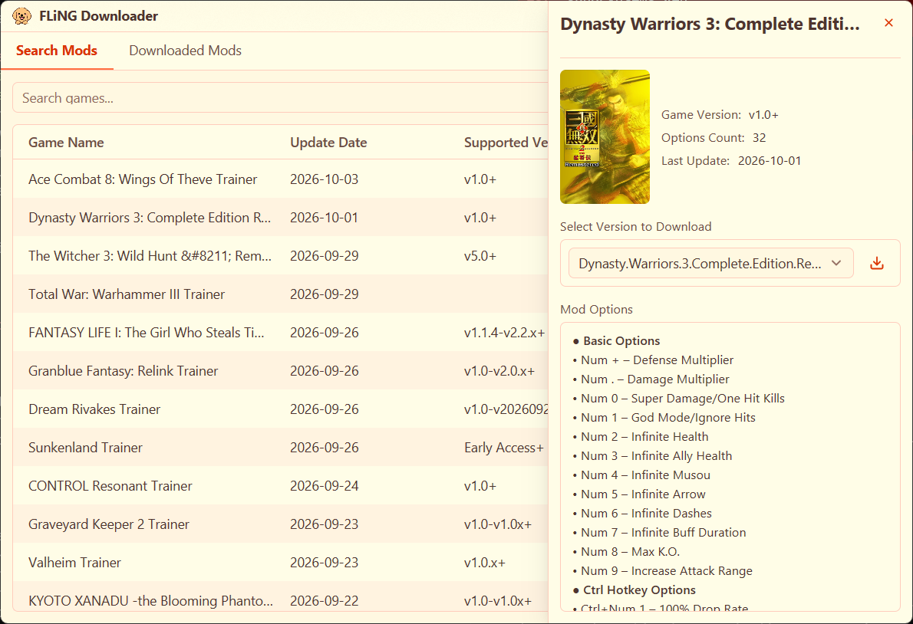

<div align="center">
  

  <h1>FLiNG Downloader</h1>

  <p>
    在 Windows 上搜索、下载和管理 <a href="https://flingtrainer.com/">风灵月影（FLiNG）</a>游戏修改器，<br>
    支持用中文、英文或日文游戏名搜索。
  </p>

  <p>
    <a href="https://github.com/Sqhh99/FLiNG-Downloader/releases/latest"></a>
    <a href="https://github.com/Sqhh99/FLiNG-Downloader/releases"></a>
    <a href="../LICENSE"></a>
    
  </p>

  <p><a href="../README.md">English</a> · <b>简体中文</b> · <a href="README.ja.md">日本語</a></p>
</div>

FLiNG Downloader 是 flingtrainer.com 的开源桌面客户端：搜索游戏，查看修改器的功能选项和支持的游戏版本，一键下载，并统一管理已下载的修改器。程序用 Rust 编写，界面由 GPU 原生渲染，无需安装任何运行库。

> [!NOTE]
> 本项目是独立的开源工具，**不隶属于**风灵月影 / flingtrainer.com 官方。软件不托管、不二次分发修改器，只按你的操作从公开网站检索并下载。游戏修改器可能违反部分游戏的用户协议，请自行判断使用风险。



## 目录

- [功能](#功能)
- [下载与安装](#下载与安装)
- [使用方法](#使用方法)
- [隐私与安全](#隐私与安全)
- [从源码构建](#从源码构建)
- [获取帮助与参与贡献](#获取帮助与参与贡献)
- [许可](#许可)

## 功能

- **用母语搜索。** 可以输入中文、英文或日文游戏名。内置的标题数据库会把中文、日文标题映射为 flingtrainer.com 使用的英文标题。不完整的标题也能搜到：输入「生化危机」或「バイオハザード」即可找到生化危机系列的修改器。输入时会显示搜索建议。
- **修改器详情一目了然。** 显示全部功能选项及其快捷键、支持的游戏版本、最后更新日期和所有可下载版本。本地 ONNX 模型会从修改器截图中自动裁剪出游戏封面。
- **下载管理。** 最多同时下载 3 个任务，可暂停、继续、重试或取消。中断的下载会从断点继续。文件扩展名（`.zip`、`.exe`、`.rar` 等）按文件实际内容自动修正。
- **已下载列表。** 「已下载修改器」页列出所有下载过的修改器，可直接打开、打开所在文件夹或删除。
- **修改器名称本地化。** 修改器名称可显示为中文或日文，例如「艾尔登法环 (Elden Ring)」，新下载的文件也按该名称保存。
- **界面随你设置。** 界面语言可在简体中文、英文、日文之间即时切换。提供 9 套主题：浅色、深色、海洋、日落、森林、薰衣草、玫瑰、午夜、摩卡。
- **内置更新。** 可从 GitHub 或 Gitee 检查软件新版本和标题数据库更新，并在设置中直接安装。

## 下载与安装

从 [Releases 页面](https://github.com/Sqhh99/FLiNG-Downloader/releases/latest)下载最新版本：

| 文件 | 说明 |
|------|------|
| `FLiNG-Downloader-v<版本>-win-x64-setup.exe` | **安装包。** 可直接覆盖安装旧版本，设置、已下载的修改器和封面都会保留。 |
| `FLiNG-Downloader-v<版本>-win-x64-portable.zip` | **便携包。** 解压到任意位置后运行 `FLiNG Downloader.exe`。 |
| `SHA256SUMS.txt` | 上面两个文件的 SHA-256 校验值。 |

**系统要求：** Windows 10 1903 及以上，64 位。无需另外安装任何组件：ONNX Runtime 已内置于程序中，安装包和便携包都附带 MSVC 运行库。

**校验下载的文件：** 与 `SHA256SUMS.txt` 对照，例如在 PowerShell 中运行：

```powershell
Get-FileHash .\FLiNG-Downloader-v<版本>-win-x64-setup.exe -Algorithm SHA256
```

> [!TIP]
> Windows Defender 或其他杀毒软件可能误报本程序（例如 `Win32/Wacapew.C!ml`）。原因和处理方法见 [杀毒软件误报 FAQ](ANTIVIRUS_FAQ.zh-CN.md)。请只从本仓库的 Releases 页面下载。

**从 1.1.x 及更早版本（Qt 版）升级：** 新版读取相同的文件，设置、已下载列表、封面缓存和标题数据库都会沿用。

## 使用方法

1. **搜索。** 输入游戏名后按 Enter，或选择一条搜索建议。点击「显示全部」，或在输入框为空时按 Enter，可查看最近更新的修改器。
2. **选择修改器。** 点击一条结果，查看它的功能选项、支持的版本和封面。
3. **下载。** 选择版本后点击「下载」。进度显示在标题栏的「下载列表」中。
4. **运行。** 在「已下载修改器」页打开修改器。

在「设置」中可以修改下载目录（默认为系统的“下载”文件夹）、界面语言和修改器名称语言、主题以及更新源。

**搜不到某个游戏，或名称翻译有误？** 请先更新标题数据库：**设置 → 关于 → 翻译数据库更新 → 检查数据库更新**。如果问题仍在，请用 [*Game title not found* 表单](https://github.com/Sqhh99/FLiNG-Downloader/issues/new?template=game-title.yml)反馈。

## 隐私与安全

- 不收集任何个人信息，没有遥测。程序只在以下情况联网：搜索 flingtrainer.com、下载修改器和封面、向 GitHub 或 Gitee 检查更新。
- 所有数据都保存在本机：
  - 设置：`%APPDATA%\FLiNG Downloader\config`；
  - 已下载列表和更新后的标题数据库：`%APPDATA%\FLiNG Downloader\data`；
  - 封面缓存：`%LOCALAPPDATA%\FLiNG Downloader\cache`。
- 报告安全漏洞请见 [安全策略](SECURITY.zh-CN.md)，请勿在公开 Issue 中描述漏洞。

## 从源码构建

需要 Rust stable（`x86_64-pc-windows-msvc`）和 Visual Studio 2022 及以上的 C++ 生成工具。不需要 Qt、CMake 或 vcpkg；ONNX Runtime 会在首次构建时自动下载并静态链接。

```bat
git clone --recurse-submodules https://github.com/Sqhh99/FLiNG-Downloader.git
cd FLiNG-Downloader

cargo run -p fling-ui                   :: 构建并运行（Debug）
cargo test --workspace                  :: 全部测试
cargo clippy --workspace --all-targets -- -D warnings
cargo fmt --all
cargo bench -p fling-cover --bench detector   :: 封面识别基准测试
cargo xtask dist [--version 1.2.3]      :: 生成发布目录 dist\FLiNG Downloader\
cargo xtask notices                     :: 重新生成 THIRD_PARTY_NOTICES.md 中的依赖列表
```

首次构建 `fling-ui` 需要几分钟。

<details>
<summary><b>项目结构</b></summary>

项目是一个前后端分离的 Cargo workspace：界面只通过 `Command` / `Event` 与后端通信。

| Crate | 职责 |
|-------|------|
| `fling-core` | 领域类型与纯函数：版本比较、标题归一化、文件类型识别 |
| `fling-net` | HTTP 抽象与 reqwest 实现（续传、Referer、超时），以及测试用的假实现 |
| `fling-config` | AppData 路径与兼容 QSettings 的 `settings.ini` |
| `fling-mapping` | 翻译数据库、中日文 → 英文标题映射、搜索建议 |
| `fling-site` | flingtrainer.com 页面解析、搜索、最近更新列表 |
| `fling-download` | 下载队列（暂停、继续、同时 3 个）与已下载列表 |
| `fling-update` | 通过 GitHub 或 Gitee 更新软件与数据库 |
| `fling-cover` | 封面缓存与 ONNX 封面识别 |
| `fling-app` | 后端门面：持有全部服务，对外暴露 `Command` / `Event` |
| `fling-ui` | GPUI 界面（`FLiNG Downloader.exe`） |
| `xtask` | 打包与仓库任务 |

</details>

<details>
<summary><b>测试</b></summary>

- 每个 crate 都有单元测试。集成测试位于 `crates/fling-app/tests`、`crates/fling-site/tests`、`crates/fling-mapping/tests` 和 `crates/fling-cover/tests`。
- 测试不访问外网，也不读写真实的 AppData：使用假 HTTP 客户端和临时目录。
- `crates/fling-site/tests/fixtures/` 保存了官网页面快照，`crates/fling-cover/tests/screenshots/` 是封面识别样本。

</details>

<details>
<summary><b>翻译数据库</b></summary>

- 程序从 SQLite 数据库 `fling_translations.db` 读取游戏标题。程序目录的 `resources/` 下自带一份。
- 数据库更新保存在 `%APPDATA%\FLiNG Downloader\data`。程序会比较它与内置库的版本，使用较新的有效版本。
- 数据库由 [game-mappings-updater](https://github.com/Sqhh99/game-mappings-updater) 生成并发布，以子模块形式位于 `tools/game-mappings-updater`（用 `git submodule update --init` 拉取）。
- 有效的数据库必须包含以下列：
  - `metadata.release_tag`
  - `metadata.schema_version`（可选；存在时必须为 `1`）
  - `games.english`、`games.normalized_english`、`games.chinese_simplified`、`games.japanese`

</details>

<details>
<summary><b>CI 与版本发布</b></summary>

- `build.yml` 执行格式检查、clippy、测试，并构建发布包。
- `make-release.yml` 构建安装包和便携包，并与 `fling_translations.db`、`SHA256SUMS.txt` 一起附加到 GitHub Release。
- 两种发布包都包含主程序、封面模型（`models/`）、内置数据库（`resources/`）和 MSVC 运行库。
- 推送以 `v` 开头的 tag 会触发 `make-release.yml`。不含 `-` 的 tag 生成正式版，含 `-` 的 tag 生成 GitHub 预发布版：

  ```bash
  git tag v1.2.3 && git push origin v1.2.3                 # 正式版
  git tag v1.2.3-beta.1 && git push origin v1.2.3-beta.1   # 预发布版
  ```

</details>

## 获取帮助与参与贡献

- **使用疑问与想法：** [Discussions](https://github.com/Sqhh99/FLiNG-Downloader/discussions)
- **缺陷与已达成共识的功能：** [Issues](https://github.com/Sqhh99/FLiNG-Downloader/issues)。新功能请先在 Discussions 中讨论。
- **贡献代码：** 请先阅读 [贡献指南](CONTRIBUTING.zh-CN.md)。
- **安全漏洞：** 请通过 [Security Advisory](https://github.com/Sqhh99/FLiNG-Downloader/security/advisories/new) 私密报告，详见 [安全策略](SECURITY.zh-CN.md)。

## 许可

FLiNG Downloader 以 [GNU AGPL v3](../LICENSE) 授权。第三方组件及其许可见 [THIRD_PARTY_NOTICES.md](../THIRD_PARTY_NOTICES.md)。
